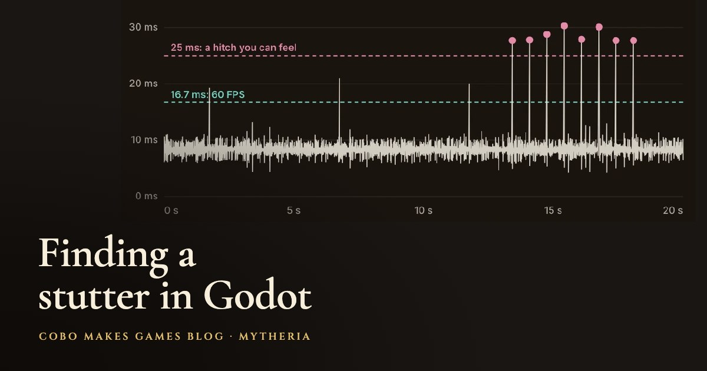

# Frame Trace for Godot 4



Find out what makes your Godot game stutter. An FPS counter averages away the slow frames you're looking for, so Frame Trace records the real time between every frame, times the jobs you name inside it, and writes a report listing the slowest frames and the job that was busy in each one.

It's a small version of the trace we use in [Mytheria](https://cobomakesgames.com/mytheria/), our pixel-art co-op game. It found a pathfinding search that stalled one frame every two-thirds of a second, and the same method took those frames over 25 ms from ten to zero. The whole story, with three real traces you can compare, is in [Godot stuttering movement: finding the cause with a trace](https://cobomakesgames.com/blog/godot-stutter-frame-trace/).

## What it does

- Measures the wall-clock gap between frames with `Time.get_ticks_usec()`, not the frame's delta, so it sees the hitch your eye sees.
- Times named jobs inside each frame (`begin`/`end`, or `measure` with a callable). Several calls of the same name in one frame add up.
- Skips a warm-up (2 s by default) so loading doesn't count, then records for a set time (30 s).
- Writes one JSON file with the median, 95th, 99th percentile and worst frame gap, the same for every job, a count of frames over your hitch line (25 ms), and the slowest frames with the busiest job in each.
- F8 starts and stops a capture in any build, so players can send you a trace from their own machine.
- Nothing is written while recording; the file is saved once at the end.

## Install

Copy `addons/frame_trace` into your project's `addons` folder and enable **Frame Trace** under Project Settings > Plugins. Enabling it adds an autoload named `FrameTrace`. Godot 4.3 and later (tested on 4.6 and 4.7).

## Use

Wrap the work you suspect:

```gdscript
func _physics_process(_delta: float) -> void:
	FrameTrace.begin(&"pathfinding")
	_update_paths()
	FrameTrace.end(&"pathfinding")

	var visible := FrameTrace.measure(&"visibility", _find_visible_enemies)
```

Run the game, press F8, play the moment that stutters, and wait for the capture to finish (or press F8 again). The console prints a summary and the file's path:

```
FrameTrace: 1792 frames, 8 over 25.0 ms, worst 30.3 ms -> .../frame_traces/frame-trace-2026-10-23T14-02-11.json
```

Open the file and look at `worst_frames`: each entry has its time, gap, every job's milliseconds and `busiest_job`. Then fix that one job and record the same route again. Keep the numbers, and throw out a change that shortens a job without shortening the frame gaps.

Settings on the autoload: `duration_seconds`, `warmup_seconds`, `hitch_ms`, `toggle_key` (set `KEY_NONE` to turn the shortcut off), `output_directory` (`user://frame_traces`) and `worst_frames`. `start()`, `stop()` and the `finished(report, path)` signal let you drive it from your own debug menu. Calls to `begin`/`end` cost almost nothing while no capture is running.

## Demo and tests

The demo stalls a fake job for 40 ms every second; press Start or F8 and read the result. The checks run with:

```
godot --headless --path . --script tests/test_frame_trace.gd
```

## License

MIT, by [Cobo Makes Games](https://cobomakesgames.com). If it helps your game, we'd love to hear about it.
